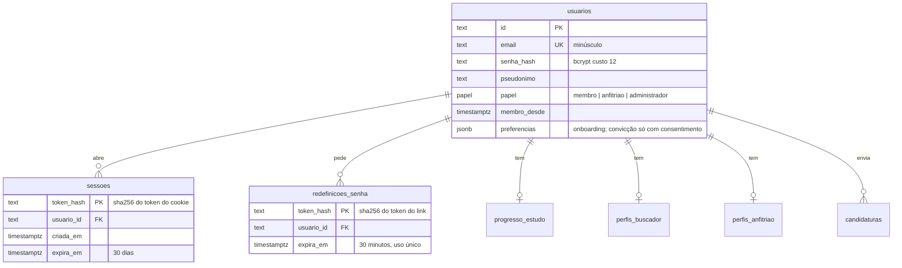
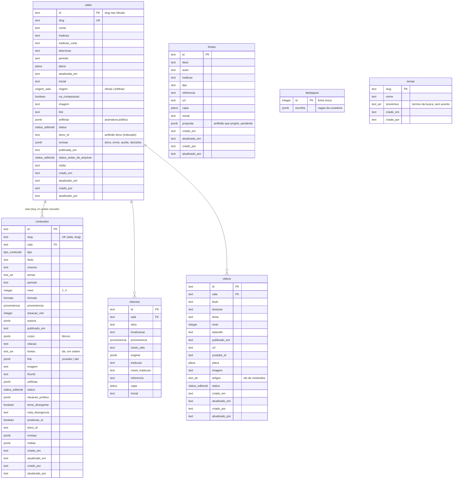
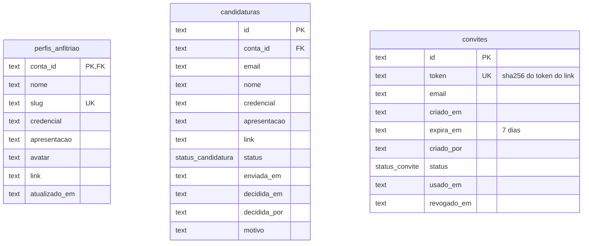
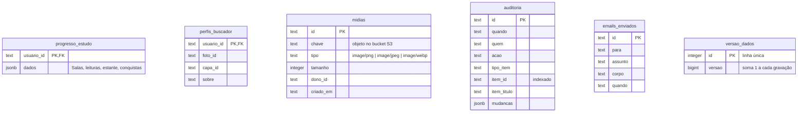
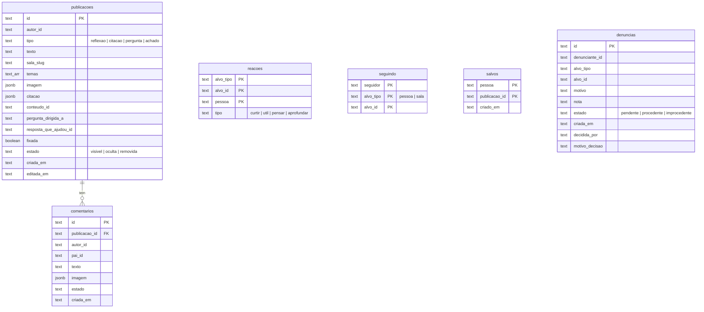

# Diagrama do banco

PostgreSQL no Supabase. Schema em Drizzle, um arquivo por módulo
(`portal/src/modules/<módulo>/<módulo>.schema.ts`), migrações em `portal/drizzle/`.
Ids em `text` (`u-…`, `c-…`, `m-…`, slugs das Salas oficiais). Datas editoriais em texto ISO,
como o domínio (`portal/src/data/types.ts`) as usa. Os bytes das imagens ficam no Supabase Storage (S3);
o banco guarda só a chave.

Todas as tabelas têm RLS ligado e nenhuma policy: a API pública do Supabase não lê nada, e o portal
conecta como dono das tabelas.

Estruturas aninhadas que são sempre lidas e gravadas junto com o item ficam em `jsonb`
(corpo do artigo, revisão do anfitrião, situação jurídica, progresso de estudo). Listas curtas de
referências ficam em `text[]` (temas e fontes do conteúdo, artigos do vídeo).

## Conta (`modules/conta`)

## Acervo (`modules/acervo`)

## Anfitriões (`modules/anfitriao`)

## Estudo, mídia e operação

## Comunidade (`modules/comunidade`)

A comunidade ainda não tem escrita no portal: as tabelas existem e são lidas, e nascem vazias.
